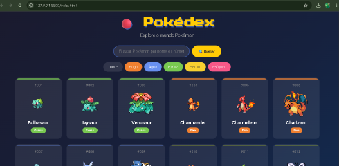

# Pokédex Full Stack

[Português](README.md) | **English**

A responsive Pokédex using **Java 21 and Spring Boot 4.1.1** for the backend and native JavaScript for the frontend. Pokémon data comes from [PokeAPI](https://pokeapi.co).

## Features

- Search by Pokémon name or number.
- Paginated listing with 20 Pokémon per page.
- Type filters.
- A details modal with statistics, height, weight and abilities.
- Responsive desktop/mobile layout and game-inspired animations.

## Technologies

Backend: Java, Spring Boot, Spring Web, Lombok and RestTemplate.

Frontend: HTML5, CSS3, JavaScript ES6+, Fetch API and DOM interactions.

## Run locally

Requires Java 21+, a modern browser and the Maven Wrapper included under `backend/`.

```bash
git clone https://github.com/GustavoBenAbraham/pokedex-fullstack.git
cd pokedex-fullstack/backend
./mvnw spring-boot:run
```

On Windows, run `.\mvnw.cmd spring-boot:run`. The backend listens on `http://localhost:8080`.

In another editor window, serve `frontend/` using VS Code Live Server or another local HTTP server. Open the URL printed by that server, typically port 5500. The application needs connectivity to retrieve PokeAPI data.

## API

| Method | Endpoint | Purpose |
| --- | --- | --- |
| GET | `/api/pokemon` | Paginated Pokémon listing |
| GET | `/api/pokemon/{id}` | Pokémon details by ID |
| GET | `/api/pokemon/search?name={name}` | Search by name |

## Preview



## What I learned

- Consume an external API with RestTemplate.
- Create a REST API with Spring Boot.
- Separate Controller, Service and DTO responsibilities.
- Use asynchronous JavaScript and DOM manipulation.
- Understand CORS and frontend/backend communication.
- Build responsive layouts with CSS Grid and Flexbox.

## Next steps

Additional type filters, focused backend unit tests and backend cloud deployment. This documentation update does not claim new test or deployment results.

## Author

[Gustavo Ben Abraham](https://github.com/GustavoBenAbraham) · [ORCID](https://orcid.org/0009-0002-8023-217X)

A learning and portfolio project.
